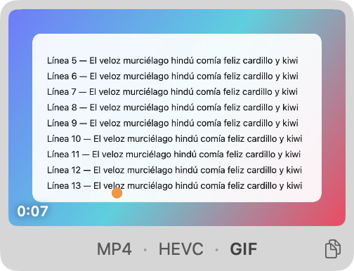

<h1 align="center">
  
</h1>

<div align="center">

**⇧⌘4, but for video.**
Record a region of your Mac screen and save it as MP4, HEVC or GIF. Nothing else.

[](https://github.com/felipebasurto/toma/releases/latest)
[](https://github.com/felipebasurto/toma/releases/latest)
[](https://swift.org)
[](LICENSE)

[Web](https://toma.felipebasurto.com) ·
[Download](https://github.com/felipebasurto/toma/releases/latest/download/Toma.dmg) ·
[Architecture](docs/arquitectura.md) ·
[Changelog](CHANGELOG.md)

</div>

Toma lives in the menu bar. You press a shortcut, draw a rectangle, and it records. There is
no settings window, no account and no editor. It records a region of your screen and saves it well.

## Install

1. Download **[Toma.dmg](https://github.com/felipebasurto/toma/releases/latest/download/Toma.dmg)** and drag Toma to Applications.
2. Open it. Toma is signed and notarized by Apple, so it opens without warnings.
3. Grant the **Screen Recording** permission, then reopen Toma.

Requires macOS 26 or later. It is universal (Apple silicon and Intel) and weighs less than 1 MB.

## Usage

<p align="center">
  
</p>

| | |
|---|---|
| <kbd>⌥</kbd> <kbd>⇧</kbd> <kbd>⌘</kbd> <kbd>4</kbd> | Start: drag a region. Recording begins as soon as you let go. |
| <kbd>Space</kbd> while dragging | Move the region. |
| <kbd>⇧</kbd> while dragging | Lock an axis. |
| <kbd>⌥</kbd> while dragging | Grow from the centre. |
| <kbd>Esc</kbd> | Cancel the selection. |
| <kbd>⌥</kbd> <kbd>⇧</kbd> <kbd>⌘</kbd> <kbd>4</kbd> again, or **■ 0:07** in the bar | Stop recording. |

When it ends, a thumbnail appears at the bottom right, like screenshots do:

- **MP4 · HEVC · GIF**: press one to save in that format.
- **Copy**: puts the file on the clipboard, ready to paste into Slack, Mail or WhatsApp.
- **Drag**: drop the thumbnail into any app or folder.
- **Do nothing**: after 6 s it saves in the last format you used.
- **×**: discards the recording.

If you press the shortcut while the thumbnail is on screen, Toma saves the recording and starts another.

## Formats

| | What for | 4 s of scrolling text, 1120 × 720 |
|---|---|---|
| **MP4** | H.264, works everywhere | 0.46 MB |
| **HEVC** | Half the size, ideal on Apple devices and modern browsers | 0.25 MB |
| **GIF** | Animation without a player, for READMEs, chats and docs | Sharp or light |

Toma first records a high-quality original and re-encodes it for quality, not for a fixed size.
Text stays sharp, and a still screen barely weighs anything. The format you usually pick starts
encoding while you look at the thumbnail, so saving it is immediate.

The GIF uses a custom encoder built for screens. Each frame only stores what changed, and interface
colours stay exact. Gradients are smoothed out without banding.

## Options

In the menu bar, each one shows its current value:

- **Save to**: a folder of your choice, or the same one screenshots use (default).
- **GIF size**: *Sharp* (full resolution, 20 fps) or *Light* (640 px, 15 fps).
- **Sound**: no sound, the Mac's sound, or the Mac's sound and your microphone.
- **Open at login**.

## Privacy

Everything happens on your Mac. Toma does not connect to the internet, has no analytics and does not
store anything outside the folder you choose. Clipboard copies are deleted after a day. Toma's own
windows never appear in its recordings.

## Build from source

You need Xcode 26 (Swift 6.2). There are no dependencies.

```bash
git clone https://github.com/felipebasurto/toma.git
cd toma
./build.sh        # → Toma.app
./build.sh dmg    # → Toma.app and Toma.dmg
```

If you have a development certificate, `build.sh` signs with it, so the Screen Recording permission
survives rebuilds. With a Developer ID certificate and a notarytool profile, `./build.sh dmg` also
notarizes and staples the disk image.

## How it's built

About 2,500 lines of Swift in a single module, organised by what each part knows:

| File | What it knows |
|---|---|
| `Toma.swift` | The state (a state machine with one verb: `toggle()`) and the history of a recording. |
| `Region.swift` | Coordinates: a region can only exist if it can be recorded exactly as drawn. |
| `Recording.swift` | ScreenCaptureKit and permissions. |
| `Library.swift` | Folders, names, formats and re-encoding. |
| `GIF.swift` | The GIF encoder. |
| `Overlay.swift`, `ResultCard.swift`, `StatusItem.swift` | The interface. |

The reasoning behind each decision is in [docs/arquitectura.md](docs/arquitectura.md).

## License

[MIT](LICENSE). Made by [Felipe Basurto](https://felipebasurto.com).
